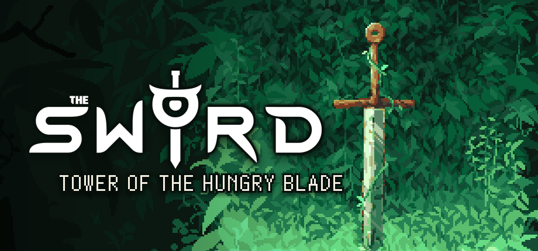

# The Sword: Tower of the Hungry Blade

**더 소드: 굶주린 마검의 탑** — CozyByte



운이 끼어들 틈이 없는 마탑 퍼즐 RPG. 말하는 마검의 외눈이 싸움마다 잃을 체력을 정확히 보여 준다.
문 하나, 열쇠 하나, 물약 하나가 모두 값이 붙은 선택이다. 100층의 길을 짜고, 마지막에 그 값을 누가 치를지 고른다.

A Magic Tower–style puzzle RPG with zero randomness. A talking demon sword's single eye shows exactly how much HP
each fight will cost, so every door, key and potion is a priced choice. Plan a route through 100 floors and decide
at the end who pays.

- Windows · 한국어 / English / 日本語 / 简体中文 · 키보드·마우스(마우스만으로도 된다), 게임패드(Xbox 배열 — 진짜 패드로 하는 점검은 아직이다)
- Steam 출시를 준비하고 있다(스토어 페이지는 아직 없다).
- 영상: [1~100층 완주](https://youtu.be/gsjcVbAoQpg) · [이야기만 모은 영상](https://youtu.be/B4liZG15ia8)

## 저장소 안내

Unity **6000.3.10f1**(URP) 프로젝트다. 에디터에서 `Assets/@Scenes/TitleScene.unity` 를 열어 플레이한다.

| 어디 | 무엇 |
|---|---|
| `Assets/@Scripts`, `@Resources`, `@Scenes` | 게임 코드·데이터·씬(`@` 가 붙은 폴더만 이 프로젝트의 것이고 나머지는 서드파티 에셋이다) |
| `Tools/` | 100층 콘텐츠 생성기와 검사(파이썬) — 전투 공식을 그대로 옮긴 시뮬레이터로 완주를 보장한 뒤에만 데이터를 쓴다 |
| `Tools/story/` | 이야기 대본(네 언어)과 검사기 |
| `Steam/` | 출시 키트 — 순서, 스토어 문구, 업적·순위표, 캡슐 그림, 업로드 스크립트 |
| `Documents/` | 출시 준비 보고서, 재미 검증, 일일 업데이트 기록 |
| `CLAUDE.md` | 구조와 규칙 전부(왜 그렇게 됐는지까지) |

Unity 없이 도는 검사:

```bash
python Tools/cscheck.py            # C# 컴파일
python Tools/validate_content.py   # 생성된 데이터·지도
python Tools/generate_content.py   # 밸런스·완주 보장(dry-run)
python Tools/rules_check.py        # 코드 규칙
```

## AI 사용 공개

이 게임은 AI 도구를 썼다. 이야기 대본·이름과 설명·화면 문구와 모든 번역, 챕터 벽(Tripo), 챕터 보스 다섯의 그림,
챕터 전용 몬스터 스무 종의 그림이 그렇다. 정확한 문장은 스토어에 싣는 공개 문단(`Steam/store/ko.md`·`en.md` 의 "AI 사용 공개")에 있다.
이 저장소의 코드와 문서에도 AI 코딩 도구(Claude Code)를 썼다.

서드파티 소프트웨어·글꼴의 고지는 `Steam/THIRD_PARTY_NOTICES.txt` 에 있다.
